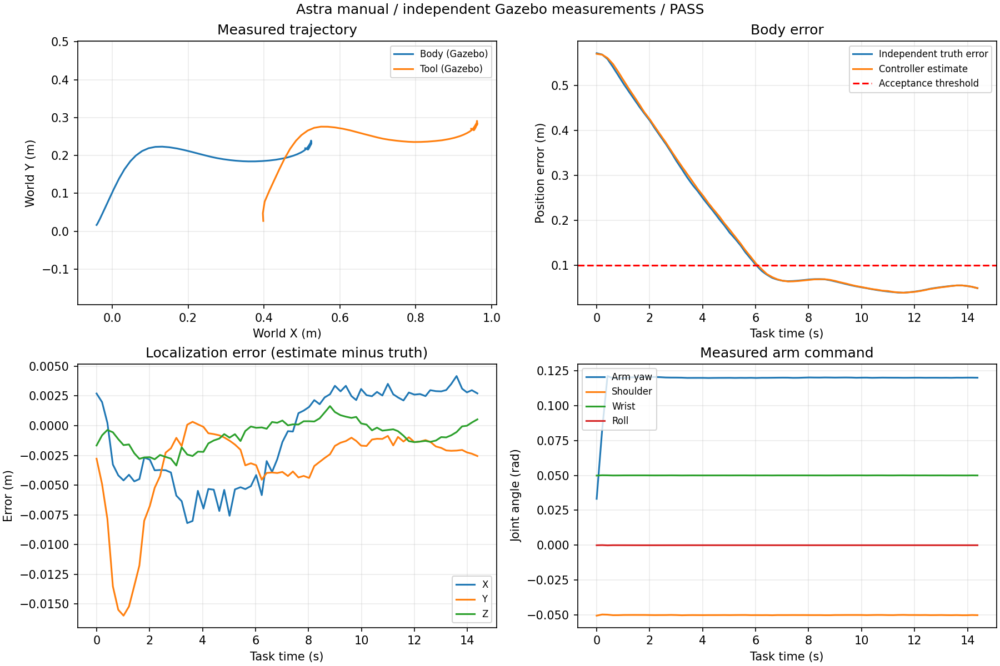
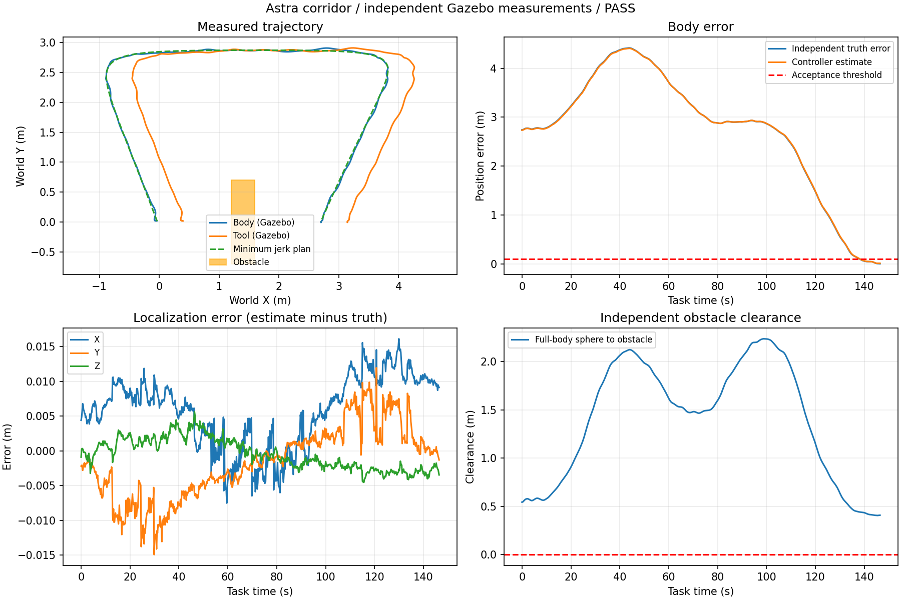
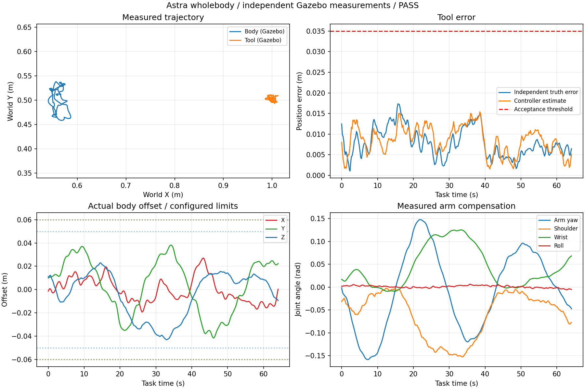

# 三个入口的实际仿真与可视化记录

2026-10-03。动力学运行于 Gazebo Classic / PX4 SITL，验收使用 `/wall_eval/body` 独立真值和机械臂关节反馈。
控制器只使用 LIO、PX4 姿态和关节编码器。数值汇总见 [three_launch_validation.json](../../tests/three_launch_validation.json)，
持续开发记录见 [PROGRESS.md](../../PROGRESS.md)。

| 场景 | 本轮实际结果 |
| --- | --- |
| 手动状态 / FK | RViz 反馈链路给机体目标，机械臂独立动作；连续 8 s 达标，末次真实机体误差 4.91 cm |
| 全身安全走廊 | 完整绕障并进入 HOLD；末次真实误差 0.71 cm，最小观测全身包络障碍净空 40.57 cm |
| 末端全身定点 | RViz 反馈链路给末端目标；连续 64.09 s 两个基准周期，工具误差最大 1.73 cm、平均 0.79 cm；机体 xyz/yaw 全程采样均在范围内 |

全身控制试验中，机体实际 xyz 峰峰运动量约 `[4.62, 7.97, 6.60] cm`，偏航变化 `0.169 rad`；
机械臂 yaw、肩、腕同时补偿，保持关节中位正则。该运动幅度是真值记录，并非只播放目标标记。
默认基准周期为 32 s；早期 16 s 单周期通过但持续试验失败，最终加入实测速度阻尼后完成上述验收。

## 启动与交互

完成 README 中的构建、source 后，一次选择一个入口。以下配置通过 RViz 和中文面板展示完整任务，省去额外 Gazebo 窗口；
需要 Gazebo 视图时使用 `gui:=true`。

```bash
ros2 launch astra_wall_control manual_flight.launch.py gui:=false
ros2 launch astra_wall_control wholebody_corridor.launch.py gui:=false
ros2 launch astra_wall_control wholebody_point.launch.py gui:=false
```

- 手动/FK：Interact 拖动机体 xyz/yaw；右键选关节并拖动轴/环。紫色表示给定状态的 FK 预览，实心模型表示实际状态。
- 走廊：起飞后设置机体目标 `(2.7, 0, 1.6)`。黄色为连续规划曲线，蓝/绿/紫为机体、末端、飞控参考轨迹；当前安全走廊绿色，下一段琥珀色。
- 全身定点：设置末端目标，例如 `(1, 0.5, 1.4)`。到点并稳定后机体在紫色范围框内摆动，机械臂联合补偿；右键可暂停/恢复摆动。

## 实际飞行曲线

以下曲线由已保存的真实飞行记录生成；末端保持测试检查真实位置、实际机体范围和实际关节变化，不能由静态悬停通过。





## RViz 与中文面板

以下截图是**上述飞行数据的只读回放**，不会发送飞行命令。三个场景均检查了 RViz `Global Status: Ok`、实际模型、
安全包络、目标和轨迹；关节表显示全部七个关节。回放没有逐帧关节速度/力矩数据时，面板对应列显示 `—`，
实际运行则订阅 JointState 显示这些字段。

| 场景 | RViz | 面板 |
| --- | --- | --- |
| 手动状态 / FK | [查看](manual/rviz.png) | [查看](manual/dashboard.png) |
| 全身安全走廊 | [查看](corridor/rviz.png) | [查看](corridor/dashboard.png) |
| 末端定点 / 有界摆动 | [查看](wholebody/rviz.png) | [查看](wholebody/dashboard.png) |

## 离线复查

源包中的压缩记录不依赖 `/tmp`。source ROS 环境后，可在隔离 domain 进行只读回放：

```bash
ROS_DOMAIN_ID=76 python3 tests/preview_visualization.py \
  --input tests/data/corridor_sitl.json.gz --scene corridor --seconds 60 --speed 4
```

手动/全身定点替换记录为 `manual_sitl.json.gz` / `wholebody_sitl.json.gz`，使用 `--scene air`。
`tests/plot_sitl.py` 可从同一压缩记录重新导出曲线，不需要运行 ROS。
雷达修复前后点云和五个房间平面的几何检查见 `tests/data/lidar_geometry_*`。

本轮验证覆盖配套静态世界、默认低速参数和指定目标。尚未验证任意障碍地图、动态障碍、实机飞行和所有连续换点组合。
自动 RViz 链路检查通过反馈话题模拟鼠标松开事件；七个关节轴映射另有真实消息回调检查，不宣称已人工拖动验收每个关节。
